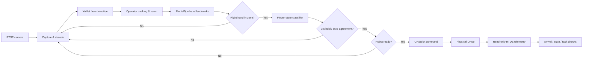

<div align="center">

# UR5e Gesture Control

### Vision-guided human–robot interaction on a physical UR5e

**From hand gesture to verified robot motion.**

Real-time perception · Intent confirmation · URScript execution · RTDE feedback

[**Watch the demo**](assets/demo/ur5e-gesture-control-demo.mp4) · [**Explore the architecture**](#system-architecture) · [**Read the technical report**](docs/UR5e_Gesture_Control_PUBLIC.pdf)


**Developed by Xamdamov Abu Bakr**

</div>

---

> [!IMPORTANT]
> **Physical robot research prototype.** The project was demonstrated on a physical UR5e. This public repository omits installation-specific waypoints, camera credentials and device addresses. It is **not ready for robot motion out of the box**, and its software interlocks are **not safety-rated**. Any deployment requires site-specific risk assessment, safeguarding and commissioning.

## At a glance

A network camera captures the operator. The vision pipeline detects and tracks a person, creates a hand-interaction zone relative to the face, and recognizes the operator's hand configuration. A gesture must remain stable for **3 seconds** with at least **85% agreement** before it requests a taught pose. The robot receives a URScript motion command; a separate, read-only RTDE channel monitors state and checks arrival.

| Perception | Decision | Motion & feedback |
| :--- | :--- | :--- |
| RTSP video, YuNet face detection, person lock, digital zoom and MediaPipe hand landmarks | Right-hand work zone, six gesture classes, temporal majority vote and cooldown | URScript `movej` / `movel`, read-only RTDE status, arrival monitoring and fault handling |

## Live demonstration

**Physical UR5e · Real-time gesture recognition · Robot motion**

[](assets/demo/ur5e-gesture-control-demo.mp4)

[**Open the full MP4 demonstration →**](assets/demo/ur5e-gesture-control-demo.mp4)

The demonstration showcases camera-based hand gesture recognition and corresponding motion of a physical UR5e manipulator.

## Key capabilities

- **Person-aware perception.** Detect and follow one operator using YuNet, with OpenCV fallback and smoothed digital framing.
- **Contextual interaction zone.** Place the active region next to the tracked face, scaled by apparent face size.
- **Right-hand gesture input.** Recognize a fist and one to five extended fingers via MediaPipe hand landmarks.
- **Deliberate activation.** Require a stable gesture for 3 seconds, using a 3.3-second window and an 85% majority threshold.
- **Non-blocking video loop.** Issue robot motions separately so the camera preview remains responsive.
- **Feedback-based completion.** Use read-only RTDE telemetry to monitor robot state, movement and target arrival.
- **Supplemental software interlocks.** Reject commands when not ready; prevent overlapping motions; monitor timeouts and latch faults. None replaces certified robot safety functions.

## System architecture



| Interface | Protocol | Role |
| :--- | :--- | :--- |
| Camera | RTSP / H.264 | Live scene acquisition |
| Robot command | URScript via TCP `30002` | Send a motion program |
| Robot feedback | RTDE via TCP `30004` | Read robot state and verify arrival |

The physical demonstration used a Hikvision-compatible camera stream and an NVIDIA-capable video decoding path, with an OpenCV fallback. Camera and robot networks should remain isolated from untrusted networks.

## Gesture-to-pose mapping

| Gesture | Target | Motion command |
| :---: | :--- | :--- |
| ✊ Fist | `FIST` | Cartesian `movel` target |
| ☝️ 1 finger | `1 finger` | Joint-space `movej` |
| ✌️ 2 fingers | `2 fingers` | Joint-space `movej` |
| 3 fingers | `3 fingers` | Joint-space `movej` |
| 4 fingers | `4 fingers` | Joint-space `movej` |
| 🖐️ 5 fingers | `5 fingers` | Joint-space `movej` |

The finger classifier uses a specific combination of raised fingers, not just an arbitrary total. Handedness and mirrored-camera orientation are installation-dependent: **verify that the physical right hand is selected before enabling motion**.

## Quick start

### Requirements

- An appropriately configured **Universal Robots UR5e** and access to its controller on a supervised, isolated network.
- RTSP-capable network camera and an operator workstation.
- Python with compatible NumPy, OpenCV and MediaPipe wheels.
- Optional FFmpeg and compatible NVIDIA hardware for accelerated RTSP decoding.
- Appropriate hardware emergency stop, guarding and documented robot-cell risk assessment.

### 1 — Clone and install

```powershell
git clone git@github.com:Xamdamov-Abu-Bakr/ur5e-gesture-control.git
cd ur5e-gesture-control

py -m venv .venv
.\.venv\Scripts\python.exe -m pip install --upgrade pip
.\.venv\Scripts\python.exe -m pip install -r requirements.txt
```

`requirements.txt` identifies the project's direct Python packages; it is not a version-locked environment. Use compatible releases and pin them once you have validated your setup.

### 2 — Set local connection details

In the same PowerShell session:

```powershell
$env:UR5E_CAMERA_IP   = "YOUR_CAMERA_IP"
$env:UR5E_CAMERA_USER = "YOUR_CAMERA_USERNAME"
$env:UR5E_ROBOT_IP    = "YOUR_ROBOT_IP"
```

The application asks for the camera password at startup; **do not commit passwords, IP addresses or credentials**. The RTSP backend may expose the authenticated URL in local process arguments while FFmpeg runs; use a dedicated, access-controlled workstation and camera account.

### 3 — Configure your own taught poses

```powershell
Copy-Item poses.example.py poses.py
```

Populate `poses.py` locally with **your own carefully taught and independently validated** targets. The template deliberately contains no executable target positions. The expected TCP pose is `[x, y, z, rx, ry, rz]` (metres and radians); joint targets use `[q1, q2, q3, q4, q5, q6]` (radians). Keep the existing pose keys. `poses.py` is excluded by `.gitignore`.

> [!CAUTION]
> A target coordinate is not a safe path. The software does not perform obstacle-aware or certified collision-free path planning. Validate the robot cell, payload, tool frame, entire travel path, protective measures and teach-pendant program before sending motion commands.

### 4 — Run only after commissioning

```powershell
.\.venv\Scripts\python.exe main.py
```

Startup requests an explicit `YES` confirmation. This is an operator acknowledgement, **not a safety mechanism**.

| Keyboard | Action |
| :---: | :--- |
| `0`–`5` | Request one of the six configured targets (real motion) |
| `g` | Toggle gesture control when permitted |
| `x` | Request software stop and latch gesture commands |
| `q` / `Esc` | Exit application; request stop if a move is active |

**A network software stop is not an emergency stop.** The physical emergency stop and safety-rated measures remain essential.

## Configuration reference

The key parameters live in [`config.py`](config.py):

| Parameter | Default | Description |
| :--- | ---: | :--- |
| `GESTURE_HOLD_S` | `3.0` s | Gesture duration required |
| Temporal majority vote | `85%` | Gesture agreement threshold |
| `COOLDOWN_S` | `1.0` s | Delay following motion |
| `MOVE_SPEED_M_S` | `0.05` m/s | Linear TCP speed for `movel` |
| `MOVE_ACCEL_M_S2` | `0.1` m/s² | Linear TCP acceleration |
| `JOINT_SPEED_RAD_S` | `0.25` rad/s | Joint speed for `movej` |
| `JOINT_ACCEL_RAD_S2` | `0.5` rad/s² | Joint acceleration |
| `MOVE_TIMEOUT_S` | `180` s | Motion monitoring timeout |
| `ZONE_GAP_X_CM` | `20` cm | Horizontal face-to-zone offset |
| `ZONE_DROP_Y_CM` | `5` cm | Vertical zone offset |
| `ZONE_SIZE_CM` | `30` cm | Nominal face-relative zone size |

The centimetre-based work zone is **an approximation** derived from an assumed 16 cm face dimension, not a calibrated real-world measurement. Joint speed and TCP speed use different units; changing either requires independent testing.

## Project structure

```text
ur5e-gesture-control/
├── README.md
├── SECURITY.md
├── THIRD_PARTY_NOTICES.md
├── requirements.txt
├── config.py                  # Public settings; addresses via environment
├── poses.example.py           # Public placeholder, no robot-specific targets
├── main.py                    # Perception and control orchestration
├── camera.py                  # RTSP capture / decoder
├── person.py                  # Face tracking and digital zoom
├── hand.py                    # MediaPipe hand landmark processing
├── gestures.py                # Gesture classification over time
├── robot.py                   # URScript motion and verification
├── rtde_client.py             # Read-only RTDE client
├── models.py                  # Model acquisition helpers
├── ui.py                      # Visual overlays
├── assets/
│   └── demo/
│       └── ur5e-gesture-control-demo.mp4
├── docs/
│   └── UR5e_Gesture_Control_PUBLIC.pdf
└── tests/
    ├── test_gesture_mapping.py
    └── test_gestures.py
```

The video is a documentation asset and is not required to run the source. Installation-specific `poses.py` remains untracked.

## Validation and engineering limitations

The accompanying [technical report](docs/UR5e_Gesture_Control_PUBLIC.pdf) documents the physical UR5e demonstration and author-reported acceptance tests. **Those results do not establish that the redacted or subsequently modified public package has been validated on hardware.** The repository's automated tests are limited to offline gesture/mapping logic.

```powershell
py -m unittest discover -s tests -v
```

**Known limitations:** no certified human detection or safeguarding; no collision-free trajectory planner; sensitivity to lighting, occlusion and camera mirroring; approximate face-based zone scaling; possible RTSP process-argument credential exposure; and a requirement to re-test the modified public safety/fault path on real hardware.

## Documentation

- **[System Flowcharts & Technical Documentation (PDF)](docs/UR5e_Gesture_Control_PUBLIC.pdf)** — architecture, tracking, gesture logic, motion execution, software interlocks and original test report (publicly redacted).
- **[Security](SECURITY.md)** — physical-safety and vulnerability reporting considerations.
- **[Third-party notices](THIRD_PARTY_NOTICES.md)** — libraries, models and upstream acknowledgements.

## Credits

**Xamdamov Abu Bakr** — implementation, physical-system demonstration and technical documentation.

The finger-state approach and general interaction concept draw inspiration from [Rebots-Spain/robodk_vision](https://github.com/Rebots-Spain/robodk_vision). This implementation uses a different physical-robot interface, through URScript and RTDE, and adds operator tracking, the gesture zone and temporal confirmation. Third-party components and model assets remain subject to their own license terms.

## License

No software license has been granted for this repository. Third-party libraries, models, and referenced work remain subject to their respective license terms.

---

<div align="center">

**Computer Vision × Robotics × Human–Robot Interaction**

*Built and documented by Xamdamov Abu Bakr*

</div>
